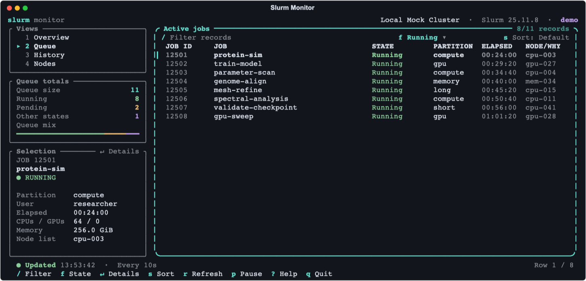

# Slurm Monitor

A read-only Slurm dashboard that runs in your terminal. Inspect partition
capacity, active queues, recent accounting, and node resources over OpenSSH.



## Try the demo

From the repository root, use Rust 1.88 or newer with Cargo.

```sh
cargo run --locked -- --demo
```

The demo uses bundled data and works without a cluster connection.

## Install

```sh
make install-bin
~/.local/bin/cluster-monitor --demo
```

`make install-bin` builds an optimized native binary for the current OS and
architecture. Set `BINDIR` to choose the destination. You can also install
through Cargo with `cargo install --path . --locked`. Run `cluster-monitor`
directly when its installation directory is in your `PATH`.

## Connect a cluster

Create a starter config and print its location.

```sh
cluster-monitor --init-config
cluster-monitor --config-path
```

The default path is `~/.config/cluster-monitor/config.yaml`. An absolute
`XDG_CONFIG_HOME` changes the base directory. Add an SSH cluster to that
YAML file, using an alias from your OpenSSH configuration.

```yaml
clusters:
  - id: research
    name: Research cluster
    backend: ssh
    ssh_host: research-hpc
    slurm_user: current
```

Start on that cluster with `cluster-monitor --cluster research` or select it
inside the app with `c`. Use `--config PATH` to load a specific file.
If the default config is absent, the monitor starts in demo mode. See the
[configuration guide](docs/configuration.md) for SSH setup and refresh intervals.

## Use the dashboard

| View | What you can inspect |
| --- | --- |
| **1 · Overview** | Partition availability, node allocation, time limits, and a heatmap of used, idle, and other nodes |
| **2 · Queue** | Running and pending jobs, elapsed time, and pending reasons |
| **3 · History** | Up to 500 finished jobs from the past seven days and available accounting details |
| **4 · Nodes** | Node states, CPU allocation, memory, partitions, and GPUs |

| Key | Action |
| --- | --- |
| `1`–`4`, `Tab`, or `Shift+Tab` | Switch views |
| `↑` `↓` or `j` `k` | Move the selection |
| `Enter` | Open the full record |
| `/` and `f` | Search by text or filter by state |
| `Esc` | Close a panel or clear filters |
| `s` | Cycle default, name, and state sort |
| `r` and `p` | Refresh or pause polling |
| `c`, `?`, and `q` | Choose a cluster, show shortcuts, or quit |

Click a view or row to select it. The state picker shows counts for the current
view, and the state and text filters work together. On wide terminals, the
selection preview sits beside the full-height table. Press `Enter` for details
at any size.

On Overview, the partition table sits above the heatmap when space allows.
The heatmap follows the table's filters and selection. Click a group of tiles
to select its partition. Every partition uses the same grid size so you can
compare the proportions of used, idle, and other nodes. The table shows the
exact counts.

The dashboard inherits your terminal's ANSI palette and background, including
the opacity set by your terminal profile. If a refresh fails, the last
successful snapshot stays visible and is marked stale.

## Development

Ratatui and Crossterm render the interface. Tokio runs read-only Slurm queries
through OpenSSH, and the client supports both JSON and fixed-field responses.

```sh
cargo test --locked
cargo fmt --check
cargo clippy --locked --all-targets -- -D warnings
```

See the [architecture](docs/architecture.md), [developer commands](docs/development.md),
and [troubleshooting guide](docs/troubleshooting.md). Released under the
[MIT License](LICENSE).
